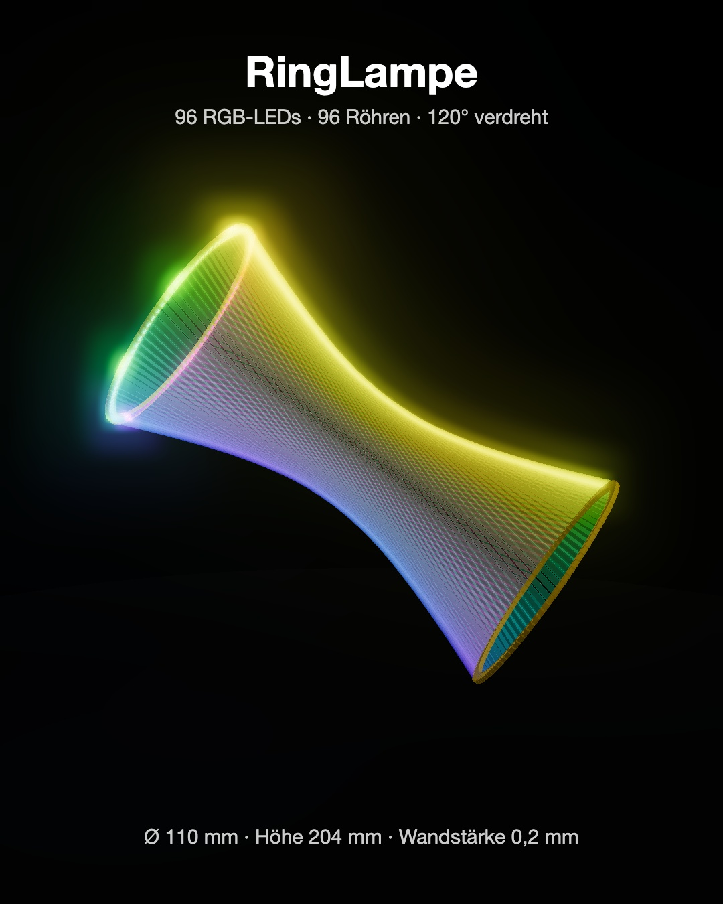
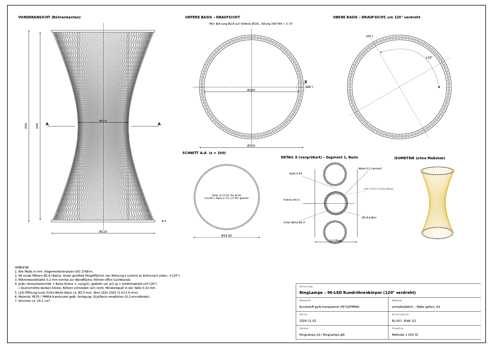

# RingLampe

Prozedural erzeugter Lampenkörper aus 96 Lichtröhren zwischen zwei LED-Ringen – mit STL/GLB-Export, technischer Zeichnung und interaktivem 3D-Viewer.

**Live-Viewer:** https://helmutqualtinger.github.io/RingLampe/



## Geometrie

| Parameter | Wert |
|---|---|
| Ringbasis | Ø außen 110 mm / Ø innen 100 mm, Dicke 2 mm |
| Segmente / LEDs | 96 viereckige Öffnungen, Teilung 3,75° |
| Abstand der Basen | 200 mm (Gesamthöhe 204 mm) |
| Verdrehung obere Basis | 120° |
| Röhren | 96, linear gelofted (Regelfläche), Wandstärke 0,2 mm normal zur Wand |
| Taille | Ø 54,5 mm bei z = 100 mm |
| Material | Kunststoff gelb transparent (PETG/PMMA) |
| Volumen | ca. 37,6 cm³ |

Jeder Horizontalschnitt ist die Basis, skaliert mit cos(φ/2) und um φ/2 gedreht. Dadurch schneiden sich die Röhren nicht (Mindestspalt in der Taille 0,3 mm).

## Dateien

| Datei | Inhalt |
|---|---|
| `generate_ringlampe.py` | Generator für alle Ausgabedateien |
| `RingLampe.stl` | Binäres STL, Einheit mm |
| `RingLampe.glb` | glTF 2.0, Einheit m, Y-up, Material gelb transparent (Transmission/IOR/Volume) |
| `RingLampe_Zeichnung.pdf` | Technische Zeichnung A3 quer |
| `ringlampe_viewer.html` | Interaktiver three.js-Viewer mit animierten RGB-LEDs |
| `index.html` | Einstieg für GitHub Pages (Social-Media-Vorschau, leitet zum Viewer weiter) |
| `og-image.jpg` | Social-Media-Vorschaubild 1200×630 |
| `manifest.webmanifest`, `sw.js`, `icons/` | PWA: installierbar, offline nach erstem Besuch |
| `package.json`, `capacitor.config.json` | Capacitor-Setup für iOS-/Android-Apps |
| `prompt.md` | Ursprüngliche Aufgabenstellung |

## Erzeugen

```bash
pip install numpy matplotlib
python3 generate_ringlampe.py
```

Die Ausgabe meldet Dreiecksanzahl, Volumen, offene Kanten (muss 0 sein) und den minimalen Spalt zwischen Nachbarröhren.

## Viewer

```bash
python3 -m http.server 8000
# http://localhost:8000/ringlampe_viewer.html
```

Der Viewer baut die Geometrie selbst in JavaScript auf (lädt nicht das GLB). Regler: Rotationsgeschwindigkeit des Regenbogens, Licht-Laufzeit nach oben, Helligkeit, Abfall nach oben, Regenbogen-Wiederholungen, Bloom, Taumeln und Kamera-Rotation. Maus: drehen, Rad: zoomen, rechte Taste: verschieben.

Mit `?record` rendert der Viewer ein 60-s-Video (1080×1350, 30 fps) Bild für Bild; `window.startRecording()` sendet jedes JPEG per POST an `/frame/NNNN` eines lokalen Servers.

## Apps für iOS und Android

Als Web-App: Seite im Browser öffnen und „Zum Home-Bildschirm“ (iOS Safari) bzw. „App installieren“ (Android Chrome) wählen.

Als native App mit [Capacitor](https://capacitorjs.com) (benötigt Xcode bzw. Android Studio):

```bash
npm install
npm run ios       # erzeugt ios/ und öffnet Xcode
npm run android   # erzeugt android/ und öffnet Android Studio
```

`npm run build` kopiert die Web-Dateien nach `www/`. three.js wird beim ersten Start vom CDN geladen und danach vom Service Worker gecacht.

## Technische Zeichnung


